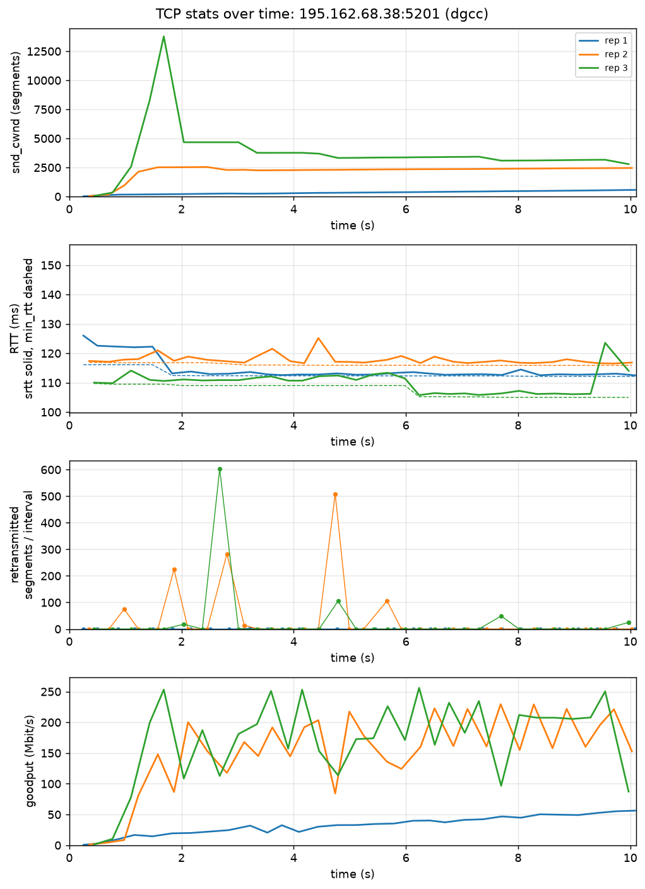
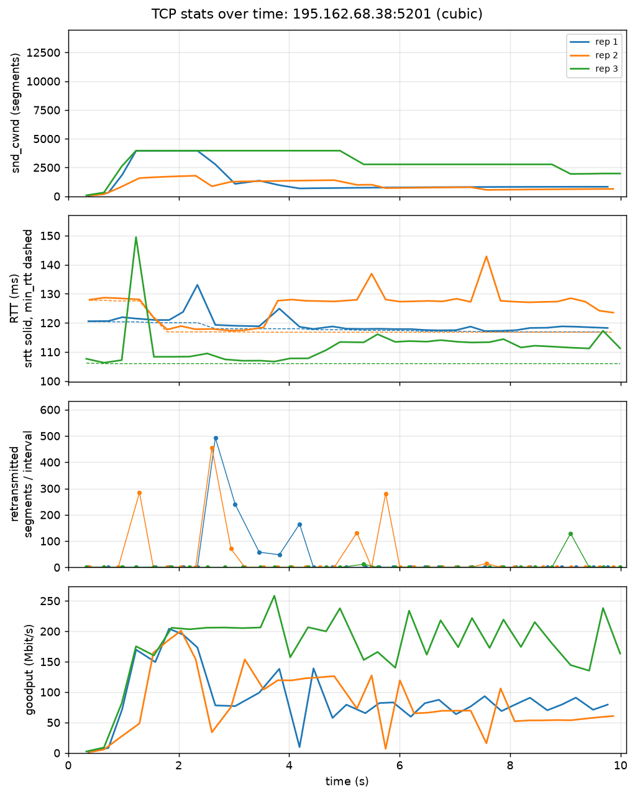
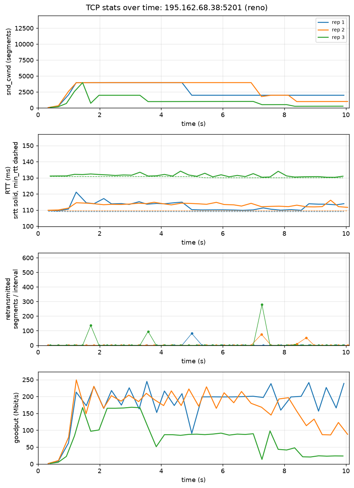
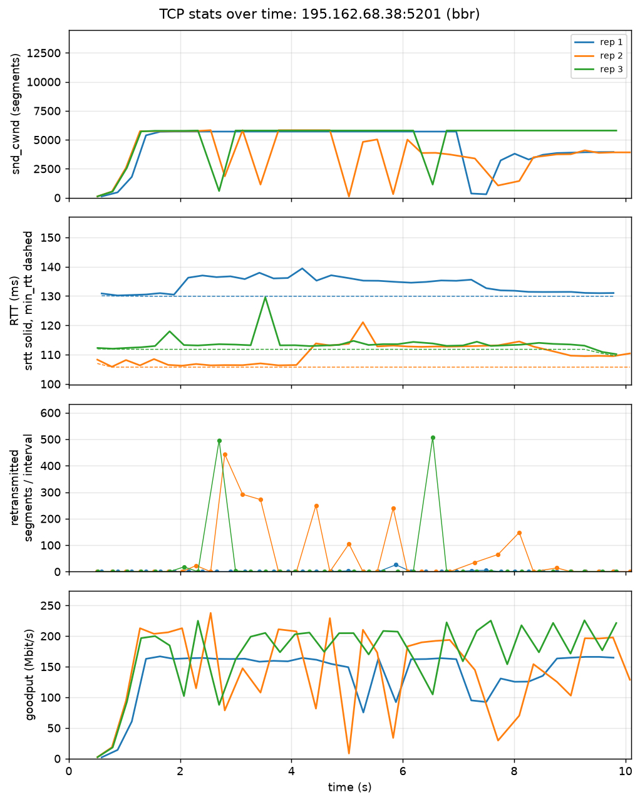
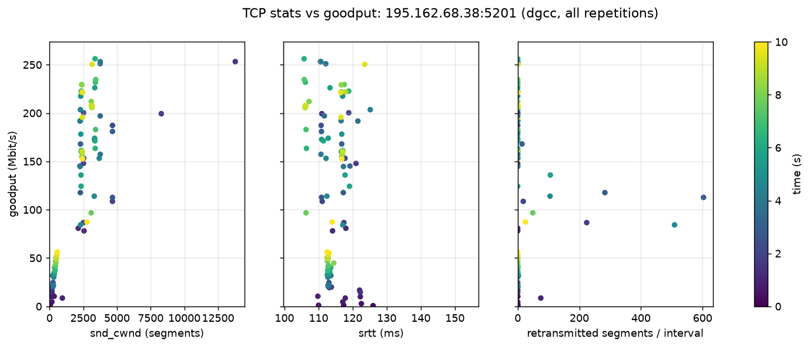
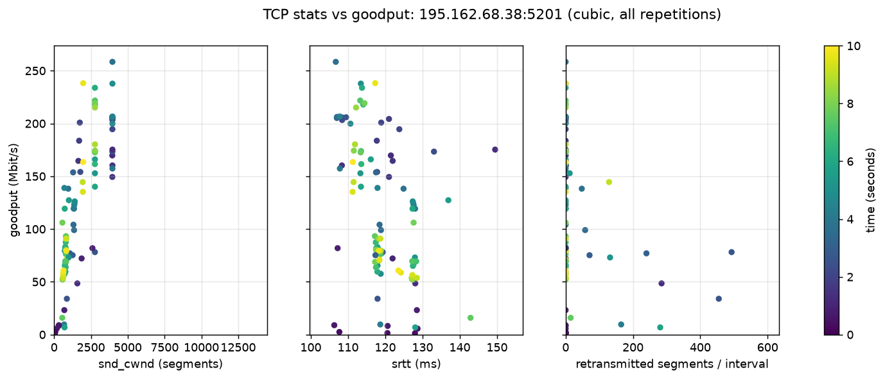
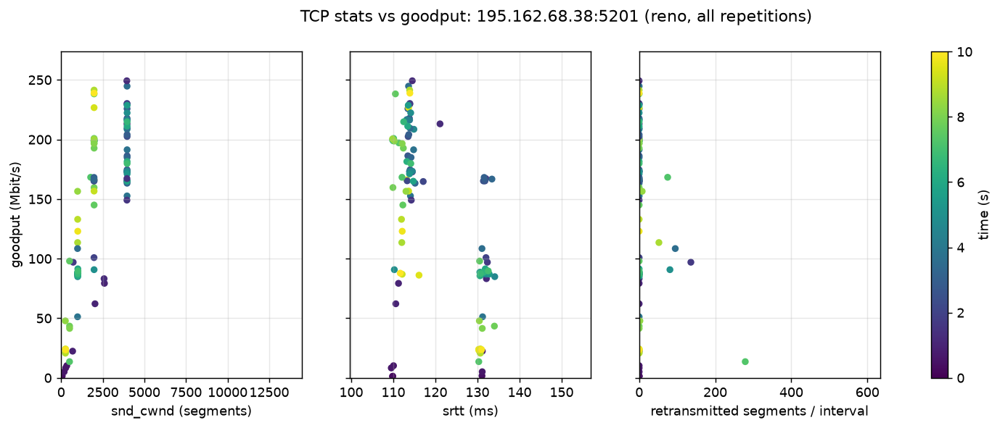
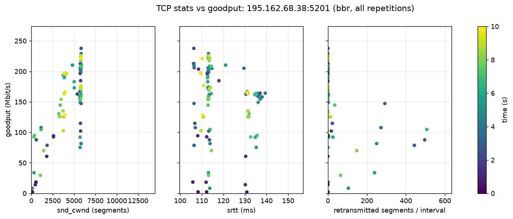

# CS 422 HW3 Report: eBPF Congestion Control (Option 1)

Repository: [CS422-Networks-Group/HW3](https://github.com/CS422-Networks-Group/HW3/tree/hw3-cleanup) (branch `hw3-cleanup`). Raw measurements: [`results/`](https://github.com/CS422-Networks-Group/HW3/tree/hw3-cleanup/results). Dependencies and reproduction: [README](https://github.com/CS422-Networks-Group/HW3/blob/hw3-cleanup/README.md).

We implemented our HW2 Q3(b) algorithm, **dgcc**, as an eBPF `struct_ops` `tcp_congestion_ops` program ([`bpf/dgcc.bpf.c`](https://github.com/CS422-Networks-Group/HW3/blob/hw3-cleanup/bpf/dgcc.bpf.c)) and compared it with CUBIC, Reno, and BBR using our HW2 Python client ([`src/main.py`](https://github.com/CS422-Networks-Group/HW3/blob/hw3-cleanup/src/main.py)).

## 1. Kernel, required features, build and load

| | |
| --- | --- |
| Kernel | `6.6.87.2-microsoft-standard-WSL2` (Ubuntu 24.04.2 on WSL2, x86_64) |
| Required features | `CONFIG_BPF_SYSCALL=y`, `CONFIG_BPF_JIT=y`, `CONFIG_DEBUG_INFO_BTF=y`; kernel ≥ 5.6 for BPF congestion control; `tcp_bbr` module for the BBR baseline |
| Toolchain | Ubuntu clang 18.1.3, libbpf-dev 1.3.0, bpftool from `linux-tools-generic` 6.8.0-147 |

```
sudo apt install -y clang llvm libbpf-dev linux-tools-common linux-tools-generic make python3-venv
make -C bpf             # build bpf/dgcc.bpf.o
sudo make -C bpf load   # register dgcc, load tcp_bbr, allow all four algorithms
cat /proc/sys/net/ipv4/tcp_available_congestion_control   # reno cubic bbr dgcc
sudo make -C bpf unload
```

**Selecting and recording the algorithm.** [`set_congestion_control()`](https://github.com/CS422-Networks-Group/HW3/blob/hw3-cleanup/src/main.py#L109-L124) sets `TCP_CONGESTION` on the data socket before `connect()`. After the transfer, [`iperf3_test()`](https://github.com/CS422-Networks-Group/HW3/blob/hw3-cleanup/src/main.py#L202-L203) reads it back from the connection and stores it with every sample. All 60 tests used the requested algorithm.

## 2. Implementation

The HW2 Q3(b) pseudocode:

```
Start up with the minimum window size

ONCE EVERY ROUND TRIP
  1. Measure:
     - base delay    = fastest round trip seen recently
     - current delay = smoothed round trip time
     - extra delay   = how far current delay is above base delay
     - goodput       = how much data got through this round trip

  2. If the connection timed out:
       Shrink window to minimum, go back to start-up mode.

  3. Else if packets were lost:
       If extra delay is large → shrink window to 60% (a real queue built up)
       If extra delay is small → shrink window to 90% (probably random loss)
       Leave start-up mode.

  4. Else if in start-up mode:
       If extra delay is getting noticeable → leave start-up mode
       Otherwise → double the window

  5. Else (normal operation):
       If extra delay is below target:
           Grow the window by a few packets.
           Grow more when far below target, less when close to it.
           If the last increase didn't raise goodput → grow only slightly.
       If extra delay is above target:
           Shrink the window by a percentage.
           Shrink more the further above target it is (never more than half).

  6. Never let the window be smaller than the minimum window size
     or bigger than about twice what the path can hold.
```

### 2.1 How cwnd is updated from RTT, loss, and throughput

The kernel calls [`dgcc_cong_control`](https://github.com/CS422-Networks-Group/HW3/blob/hw3-cleanup/bpf/dgcc.bpf.c#L247-L281) on every ACK. Once per round trip it calls [`dgcc_round()`](https://github.com/CS422-Networks-Group/HW3/blob/hw3-cleanup/bpf/dgcc.bpf.c#L166-L245), which applies the pseudocode:

- **RTT** ([L173–L192](https://github.com/CS422-Networks-Group/HW3/blob/hw3-cleanup/bpf/dgcc.bpf.c#L173-L192)): base delay = smallest RTT sample in a round, replaced when a smaller one is seen or after 10 s. Extra delay = max(0, srtt − base). Target = base / 8, clamped to [2, 20] ms.
- **Loss** ([L198–L208](https://github.com/CS422-Networks-Group/HW3/blob/hw3-cleanup/bpf/dgcc.bpf.c#L198-L208)): if packets were marked lost in the round, cwnd × 0.6 when extra > target, otherwise × 0.9, and start-up ends.
- **Timeout** ([`dgcc_set_state`](https://github.com/CS422-Networks-Group/HW3/blob/hw3-cleanup/bpf/dgcc.bpf.c#L148-L163)): on `TCP_CA_Loss` (RTO), cwnd = 4 and back to start-up.
- **Start-up** ([L209–L214](https://github.com/CS422-Networks-Group/HW3/blob/hw3-cleanup/bpf/dgcc.bpf.c#L209-L214), [L264–L267](https://github.com/CS422-Networks-Group/HW3/blob/hw3-cleanup/bpf/dgcc.bpf.c#L264-L267)): cwnd grows by the acked packets on every ACK (doubling per round) until extra ≥ target / 2.
- **Below target** ([L215–L221](https://github.com/CS422-Networks-Group/HW3/blob/hw3-cleanup/bpf/dgcc.bpf.c#L215-L221)): cwnd += 2 + 6 · (target − extra) / target, i.e. 2–8 segments.
- **Throughput** ([L180–L186](https://github.com/CS422-Networks-Group/HW3/blob/hw3-cleanup/bpf/dgcc.bpf.c#L180-L186), [L218–L219](https://github.com/CS422-Networks-Group/HW3/blob/hw3-cleanup/bpf/dgcc.bpf.c#L218-L219)): round goodput = delivered packets × MSS × 8 / round duration. If the previous round increased cwnd and goodput did not rise, the increase is only 1 segment.
- **Above target** ([L222–L230](https://github.com/CS422-Networks-Group/HW3/blob/hw3-cleanup/bpf/dgcc.bpf.c#L222-L230)): cwnd −= cwnd · min(50%, (extra − target) / (extra + target)).
- **Bounds** ([L232–L240](https://github.com/CS422-Networks-Group/HW3/blob/hw3-cleanup/bpf/dgcc.bpf.c#L232-L240), [L275–L279](https://github.com/CS422-Networks-Group/HW3/blob/hw3-cleanup/bpf/dgcc.bpf.c#L275-L279)): 4 ≤ cwnd ≤ 2 · max_bw · base RTT / MSS, where max_bw is the largest round goodput, kept for up to 10 rounds.

### 2.2 Initial state and parameters

Initial state ([`dgcc_init`](https://github.com/CS422-Networks-Group/HW3/blob/hw3-cleanup/bpf/dgcc.bpf.c#L104-L122)): cwnd = 4, start-up mode, base RTT and bandwidth unknown, ssthresh unset.

| Parameter ([L23–L36](https://github.com/CS422-Networks-Group/HW3/blob/hw3-cleanup/bpf/dgcc.bpf.c#L23-L36)) | Value |
| --- | --- |
| Minimum window | 4 segments |
| Delay target | base RTT / 8, clamped to [2, 20] ms |
| Start-up exit | extra delay ≥ target / 2 |
| Loss cut | × 0.6 if extra > target, × 0.9 otherwise |
| Additive increase | 2–8 segments per round, 1 if the previous increase did not raise goodput |
| Delay-based decrease | (extra − target) / (extra + target), at most 50% |
| Base RTT window | 10 s |
| Bandwidth window | max round goodput, kept for up to 10 rounds |
| Upper bound | 2 × BDP |
| Hold after a decrease | 1 round |

### 2.3 Changes from the pseudocode

The pseudocode left "large", "noticeable", "a few", "a percentage", and the target unspecified; the parameters above fill them in. Other changes:

1. Start-up grows cwnd on every ACK instead of doubling it at the end of a round.
2. After any decrease, the next round makes no decision, so one congestion event does not cause repeated cuts.
3. A loss the kernel later marks spurious is undone ([`dgcc_undo_cwnd`](https://github.com/CS422-Networks-Group/HW3/blob/hw3-cleanup/bpf/dgcc.bpf.c#L133-L145)).
4. The 2 × BDP cap is not applied during start-up.
5. dgcc sets the pacing rate ([L88–L102](https://github.com/CS422-Networks-Group/HW3/blob/hw3-cleanup/bpf/dgcc.bpf.c#L88-L102)), because `cong_control` replaces the kernel's pacing update.
6. Timeouts are handled in `set_state` rather than in the per-round logic.

## 3. Experiment

- **Algorithms:** dgcc, CUBIC, Reno, BBR.
- **Destinations:** 5 public iperf3 servers drawn at random from [`data/listed_iperf3_servers.csv`](https://github.com/CS422-Networks-Group/HW3/blob/hw3-cleanup/data/listed_iperf3_servers.csv): 23.106.226.75:5201, 80.67.167.93:9200, 185.93.2.193:5201, 195.162.68.38:5201, 69.48.237.66:30001.
- **Duration and sampling interval:** 10 s per test, sampled every 0.25 s, for all four algorithms.
- **Repetitions:** 3 per algorithm per destination, i.e. **15 tests per algorithm, 60 tests total**.
- **Logged per sample** ([`tcp_sample()`](https://github.com/CS422-Networks-Group/HW3/blob/hw3-cleanup/src/main.py#L44-L76), [`results/tcp_stats.csv`](https://github.com/CS422-Networks-Group/HW3/blob/hw3-cleanup/results/tcp_stats.csv)): `snd_cwnd`, throughput (Δ`bytes_acked` × 8 / Δt), `srtt` and `min_rtt`, and the loss signal (retransmitted segments per interval).

**Test order.** [`run_destination()`](https://github.com/CS422-Networks-Group/HW3/blob/hw3-cleanup/src/main.py#L304-L332) runs all repetitions at one destination before moving to the next. Repetition *r* uses the algorithm list rotated by *r − 1* ([`rep_order()`](https://github.com/CS422-Networks-Group/HW3/blob/hw3-cleanup/src/main.py#L299-L301)):

| Rep | Order |
| --- | --- |
| 1 | dgcc, cubic, reno, bbr |
| 2 | cubic, reno, bbr, dgcc |
| 3 | reno, bbr, dgcc, cubic |

## 4. Results

### 4.1 Time series and scatter plots

All plots use the same representative destination, **195.162.68.38:5201**, chosen by [`pick_representative()`](https://github.com/CS422-Networks-Group/HW3/blob/hw3-cleanup/src/main.py#L335-L338) (median of the per-destination mean goodput). Each figure is one algorithm with one line per repetition, and every axis has the same range in all four algorithms' figures ([`analyze()`](https://github.com/CS422-Networks-Group/HW3/blob/hw3-cleanup/src/main.py#L455-L459)).

#### TCP stats over time (195.162.68.38:5201)



*Figure 1a: dgcc. Generated by [`plot_tcp_stats()`](https://github.com/CS422-Networks-Group/HW3/blob/hw3-cleanup/src/main.py#L406-L445).*



*Figure 1b: CUBIC. Generated by [`plot_tcp_stats()`](https://github.com/CS422-Networks-Group/HW3/blob/hw3-cleanup/src/main.py#L406-L445).*



*Figure 1c: Reno. Generated by [`plot_tcp_stats()`](https://github.com/CS422-Networks-Group/HW3/blob/hw3-cleanup/src/main.py#L406-L445).*



*Figure 1d: BBR. Generated by [`plot_tcp_stats()`](https://github.com/CS422-Networks-Group/HW3/blob/hw3-cleanup/src/main.py#L406-L445).*

#### TCP stats vs goodput (195.162.68.38:5201)



*Figure 2a: dgcc. Generated by [`plot_tcp_stats()`](https://github.com/CS422-Networks-Group/HW3/blob/hw3-cleanup/src/main.py#L406-L445).*



*Figure 2b: CUBIC. Generated by [`plot_tcp_stats()`](https://github.com/CS422-Networks-Group/HW3/blob/hw3-cleanup/src/main.py#L406-L445).*



*Figure 2c: Reno. Generated by [`plot_tcp_stats()`](https://github.com/CS422-Networks-Group/HW3/blob/hw3-cleanup/src/main.py#L406-L445).*



*Figure 2d: BBR. Generated by [`plot_tcp_stats()`](https://github.com/CS422-Networks-Group/HW3/blob/hw3-cleanup/src/main.py#L406-L445).*

### 4.2 Aggregate statistics

Over all samples from 5 destinations × 3 repetitions ([`results/aggregate.csv`](https://github.com/CS422-Networks-Group/HW3/blob/hw3-cleanup/results/aggregate.csv), computed by [`summarize()`](https://github.com/CS422-Networks-Group/HW3/blob/hw3-cleanup/src/main.py#L347-L393)).

| | dgcc | CUBIC | Reno | BBR |
| --- | --- | --- | --- | --- |
| goodput mean (Mbit/s) | 129.4 | 141.0 | 117.1 | 151.4 |
| goodput median (Mbit/s) | 153.2 | 155.8 | 119.8 | 158.9 |
| goodput p95 (Mbit/s) | 237.5 | 228.4 | 225.8 | 237.0 |
| srtt mean (ms) | 119.2 | 120.3 | 118.9 | 124.1 |
| srtt median (ms) | 113.9 | 118.7 | 114.2 | 113.3 |
| srtt p95 (ms) | 144.9 | 143.3 | 144.2 | 149.6 |

### 4.3 Discussion

**TODO:** explain the observed differences in throughput and RTT, using the tables above and Figures 1–2.

## AI use

Claude Code (Claude Opus) was used to:

- write the eBPF implementation from our pseudocode;
- extend the HW2 client for four algorithms, repetitions, and aggregate statistics;
- run the experiments;
- draft this report.

We reviewed the code and checked the analysis against the raw data.
