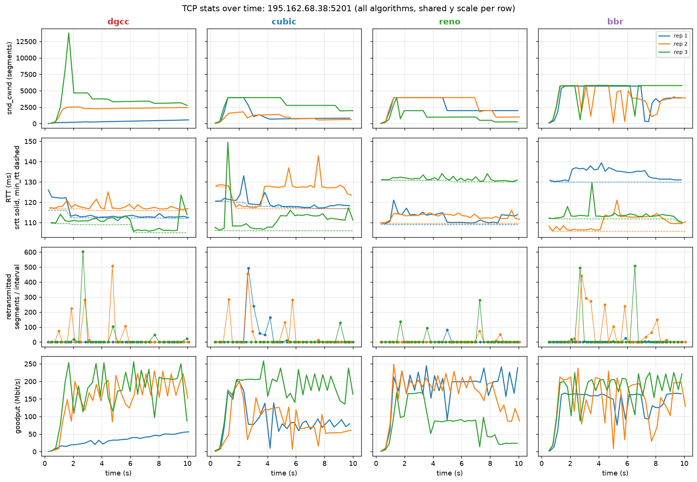
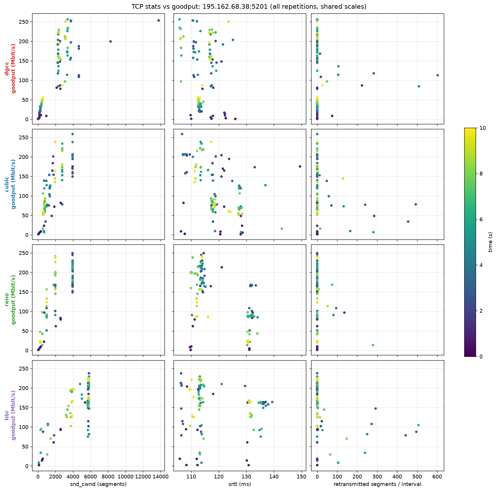
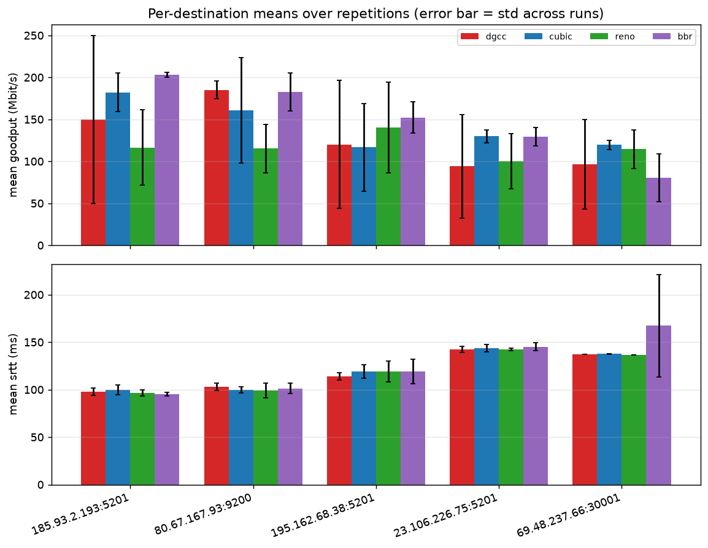
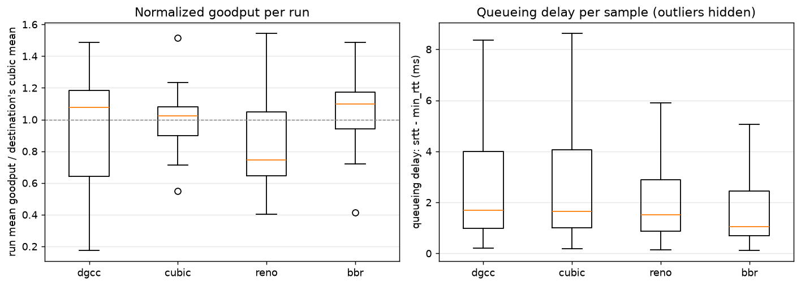

# CS 422 HW3 Report: eBPF Congestion Control (Option 1)

Repository: [CS422-Networks-Group/HW3](https://github.com/CS422-Networks-Group/HW3/tree/seth) (branch `seth`). All code links below point to that branch.

We implemented our HW2 Q3(b) algorithm, **dgcc** ("delay + goodput congestion control"), as an eBPF `struct_ops` `tcp_congestion_ops` program ([`bpf/dgcc.bpf.c`](https://github.com/CS422-Networks-Group/HW3/blob/seth/bpf/dgcc.bpf.c)). We then compared it with the kernel's CUBIC, Reno, and BBR using the HW2 iperf3-compatible Python client ([`src/main.py`](https://github.com/CS422-Networks-Group/HW3/blob/seth/src/main.py)).

## 1. Environment, build, and load

| | |
| --- | --- |
| Kernel | `6.6.87.2-microsoft-standard-WSL2` (Ubuntu 24.04.2 on WSL2, x86_64) |
| Required kernel features | `CONFIG_BPF_SYSCALL=y`, `CONFIG_BPF_JIT=y`, `CONFIG_DEBUG_INFO_BTF=y` (`/sys/kernel/btf/vmlinux`, needed for `struct_ops` and CO-RE), `tcp_bbr` module for the BBR baseline. BPF congestion control needs kernel ≥ 5.6. dgcc uses the 2-argument `cong_control(sk, rs)` hook, which has this signature up to 6.9. |
| Toolchain | Ubuntu clang 18.1.3, libbpf-dev 1.3.0, bpftool from `linux-tools-generic` 6.8.0-147 |
| Python | 3.12.3, pandas 3.0.6, matplotlib 3.11.2 |

```
sudo apt install -y clang llvm libbpf-dev linux-tools-common linux-tools-generic
make -C bpf               # bpftool btf dump -> vmlinux.h; clang -O2 -g -target bpf -> dgcc.bpf.o
sudo make -C bpf load     # modprobe tcp_bbr; bpftool struct_ops register dgcc.bpf.o;
                          # sysctl net.ipv4.tcp_allowed_congestion_control="reno cubic bbr dgcc"
cat /proc/sys/net/ipv4/tcp_available_congestion_control   # -> reno cubic bbr dgcc
sudo make -C bpf unload   # bpftool struct_ops unregister name dgcc
```

The build and load targets are in [`bpf/Makefile`](https://github.com/CS422-Networks-Group/HW3/blob/seth/bpf/Makefile). Registration goes through the kernel's BPF verifier. After loading, `dgcc` appears in `tcp_available_congestion_control` next to the built-in modules. The `sysctl` lets an unprivileged process select it with `setsockopt(TCP_CONGESTION)`.

**Selecting and recording the algorithm.** [`set_congestion_control()`](https://github.com/CS422-Networks-Group/HW3/blob/seth/src/main.py#L105-L120) sets `TCP_CONGESTION` on the iperf3 *data* socket before `connect()` and reads it back. After the 10 s transfer, [`run_test()`](https://github.com/CS422-Networks-Group/HW3/blob/seth/src/main.py#L181-L183) reads `TCP_CONGESTION` from the established connection again. That value goes in the `algorithm` column of every sample, and the test fails if it differs from the requested algorithm. All 60 tests reported the requested algorithm.

## 2. Implementation

### 2.1 Mapping the pseudocode to the kernel hooks

dgcc implements `cong_control` instead of `cong_avoid`. The kernel calls `cong_control` on every ACK with a `rate_sample` (newly acked/SACKed packets, packets newly marked lost, RTT sample, delivered count). With `cong_control`, the algorithm owns `snd_cwnd`: the kernel's PRR/slow-start code is not applied, the same arrangement BBR uses.

| Hook | Lines | Role |
| --- | --- | --- |
| [`dgcc_init`](https://github.com/CS422-Networks-Group/HW3/blob/seth/bpf/dgcc.bpf.c#L124-L143) | 124–143 | Initial state: `cwnd = 4`, start-up mode, empty estimates. |
| [`dgcc_cong_control`](https://github.com/CS422-Networks-Group/HW3/blob/seth/bpf/dgcc.bpf.c#L284-L313) | 284–313 | Every ACK: collect per-round min RTT and losses, grow in start-up, detect the end of a round, apply bounds, set pacing rate. |
| [`dgcc_round`](https://github.com/CS422-Networks-Group/HW3/blob/seth/bpf/dgcc.bpf.c#L189-L282) | 189–282 | **Once every round trip**: pseudocode steps 1 and 3–6. |
| [`dgcc_set_state`](https://github.com/CS422-Networks-Group/HW3/blob/seth/bpf/dgcc.bpf.c#L170-L186) | 170–186 | Step 2: on `TCP_CA_Loss` (retransmission timeout) → `cwnd = 4`, back to start-up. |
| [`dgcc_undo_cwnd`](https://github.com/CS422-Networks-Group/HW3/blob/seth/bpf/dgcc.bpf.c#L154-L167) | 154–167 | Kernel found the loss spurious: discard the round's losses, restore the pre-cut cwnd. |
| [`dgcc_ssthresh`](https://github.com/CS422-Networks-Group/HW3/blob/seth/bpf/dgcc.bpf.c#L147-L151) | 147–151 | Required by the kernel. Returns the current `snd_ssthresh` unchanged, because dgcc sets ssthresh itself when start-up ends and on every loss cut. |

**Round detection** ([L301–L305](https://github.com/CS422-Networks-Group/HW3/blob/seth/bpf/dgcc.bpf.c#L301-L305)) uses the same test as BBR. At the start of a round we save `tp->delivered`. The round ends when an ACK's `rs->prior_delivered` reaches that value, i.e. a packet sent after the round began has been acknowledged.

### 2.2 How cwnd is updated from RTT, loss, and throughput

Per round, [`dgcc_round()`](https://github.com/CS422-Networks-Group/HW3/blob/seth/bpf/dgcc.bpf.c#L189-L282) does the following.

**Step 1: Measure** ([L198–L217](https://github.com/CS422-Networks-Group/HW3/blob/seth/bpf/dgcc.bpf.c#L198-L217))

- *base delay* = the smallest `rs->rtt_us` seen in a round. It is replaced when a round sees a smaller value or when it is more than 10 s old ("fastest round trip seen recently").
- *current delay* = the kernel's smoothed RTT, `tp->srtt_us >> 3`.
- *extra delay* = max(0, srtt − base).
- *target* = base / 8, clamped to [2 ms, 20 ms].
- *goodput* = (`tp->delivered` at round end − at round start) × MSS × 8 / round duration (from `tp->tcp_mstamp`).
- The *bandwidth estimate* `max_bw` is the largest round goodput over the last 10 rounds.

**Step 2: Timeout.** Handled in `dgcc_set_state` (above).

**Step 3: Loss** ([L224–L237](https://github.com/CS422-Networks-Group/HW3/blob/seth/bpf/dgcc.bpf.c#L224-L237)). If any packets were marked lost during the round (Σ `rs->losses` > 0), the queue-vs-random-loss decision uses the extra delay:

- extra > target → `cwnd *= 0.6` (a queue built up)
- otherwise → `cwnd *= 0.9` (probably random loss)

Either way dgcc leaves start-up and sets `snd_ssthresh` to the new cwnd.

**Step 4: Start-up** ([L238–L244](https://github.com/CS422-Networks-Group/HW3/blob/seth/bpf/dgcc.bpf.c#L238-L244), [L296–L299](https://github.com/CS422-Networks-Group/HW3/blob/seth/bpf/dgcc.bpf.c#L296-L299)). While in start-up, every ACK adds the newly acked packets to cwnd, which doubles it once per round. At the end of each round, start-up ends if extra ≥ target / 2 ("extra delay is getting noticeable").

**Step 5: Normal operation** ([L245–L265](https://github.com/CS422-Networks-Group/HW3/blob/seth/bpf/dgcc.bpf.c#L245-L265))

- *Below target:* `cwnd += 2 + 6·(target − extra)/target`, which is +8 segments when there is no queue and +2 near the target. If the previous round also increased cwnd and this round's goodput did not exceed the previous round's, the increase is only **+1** (the throughput signal).
- *At or above target:* `cwnd -= cwnd · min(50%, (extra − target)/(extra + target))`. This is ≈ 5% at 1.1× target, 33% at 2× target, and 50% from 3× target upward.

**Step 6: Bounds** ([L267–L277](https://github.com/CS422-Networks-Group/HW3/blob/seth/bpf/dgcc.bpf.c#L267-L277), [L307–L311](https://github.com/CS422-Networks-Group/HW3/blob/seth/bpf/dgcc.bpf.c#L307-L311)). `4 ≤ cwnd ≤ 2 · max_bw · base_rtt / MSS` ("about twice what the path can hold"), and never above `snd_cwnd_clamp`.

**Pacing** ([L108–L122](https://github.com/CS422-Networks-Group/HW3/blob/seth/bpf/dgcc.bpf.c#L108-L122)). A `cong_control` algorithm replaces the call that normally updates `sk_pacing_rate`. dgcc therefore sets it to 2 × cwnd/srtt in start-up and 1.2 × cwnd/srtt otherwise, the same ratios as the kernel's `tcp_update_pacing_rate()`. This keeps TSO sizing and TCP small queues working as they would for Reno or CUBIC. No `fq` qdisc was used, so pacing is not enforced.

### 2.3 Initial state and parameters

Per-socket state is the `struct dgcc` in `icsk_ca_priv` ([L41–L56](https://github.com/CS422-Networks-Group/HW3/blob/seth/bpf/dgcc.bpf.c#L41-L56), 64 of the 104 available bytes). The initial state is `cwnd = 4`, `startup = 1`, base RTT and bandwidth unknown (0), `ssthresh` left at the kernel's "infinite" value until the first exit from start-up, and the first round starting at the current `tp->delivered`.

| Parameter ([L23–L36](https://github.com/CS422-Networks-Group/HW3/blob/seth/bpf/dgcc.bpf.c#L23-L36)) | Value |
| --- | --- |
| Minimum window | 4 segments |
| Delay target | base RTT / 8, clamped to [2, 20] ms |
| Start-up exit | extra delay ≥ target / 2 |
| Loss cut | ×0.6 if extra > target, ×0.9 otherwise |
| Additive increase | 2–8 segments per round, 1 if the previous increase did not raise goodput |
| Delay-based decrease | (extra − target)/(extra + target), at most 50% |
| Base RTT window | 10 s |
| Bandwidth window | max over 10 rounds |
| Upper bound | 2 × BDP |
| Hold after a decrease | 1 round |

### 2.4 Changes from the HW2 pseudocode

The pseudocode left "large", "noticeable", "a few", "a percentage", and the target unspecified. The values above are our choices. Beyond those, the implementation differs from the pseudocode in these ways:

1. **Start-up growth is per ACK.** Instead of doubling cwnd once at the end of a round, cwnd grows by each ACK's newly acked packets. That is the same doubling per round, without a burst of 2× cwnd at the round boundary.
2. **One-round hold after any decrease** (loss, delay, or timeout). srtt is an EWMA that keeps showing the old queue for a while after cwnd drops. Recovery from a single loss episode also often spans two rounds. Without the hold, one congestion event caused two or three cuts in a row.
3. **Undo on spurious loss.** The pseudocode has no notion of it. Because the kernel can declare a loss spurious (e.g. via DSACK), dgcc restores the pre-cut cwnd in `undo_cwnd`.
4. **The 2×BDP cap is not applied during start-up.** The goodput measured in a start-up round reflects the previous round's cwnd, so the cap would be exactly the doubled cwnd and stop start-up early.
5. **Pacing rate** is maintained (see 2.2). The pseudocode does not mention pacing.
6. **Timeout** is detected via the kernel's transition to `TCP_CA_Loss` (RTO), not inside the per-round logic, so it takes effect immediately.

### 2.5 Kernel-side counters

The program keeps global counters in its `.bss` map (`dgcc_stats`, [L59–L77](https://github.com/CS422-Networks-Group/HW3/blob/seth/bpf/dgcc.bpf.c#L59-L77)) for every branch: rounds, timeouts, 0.6/0.9 loss cuts, start-up exits, increases, +1 increases, delay decreases, holds, cap hits, and undos. `sudo make -C bpf stats` dumps them, and [`scripts/bpf_stats.py`](https://github.com/CS422-Networks-Group/HW3/blob/seth/scripts/bpf_stats.py) prints the per-session difference. They show that the kernel ran each branch.

## 3. Experiment

**Method.** We used the HW2 client unchanged except for the algorithm list, repetitions, and duration: an iperf3 control and data connection, 128 KiB `sendall()` blocks, and `TCP_INFO` read from the data socket. Every algorithm used the same settings:

- **Destinations:** 5 public iperf3 servers, drawn at random from [`data/listed_iperf3_servers.csv`](https://github.com/CS422-Networks-Group/HW3/blob/seth/data/listed_iperf3_servers.csv) (shuffle seed `3624686937`).
- **Duration:** 10 s per test.
- **Sampling interval:** 0.25 s. The actual interval is longer when a `sendall()` blocks, and goodput divides by the measured interval.
- **Repetitions:** 3 per algorithm per destination, i.e. **15 tests per algorithm, 60 tests total**.

Session `20261022T233436`, run on 2026-10-22 from 23:34 for 14.2 minutes.

**Test order.** [`run_destination()`](https://github.com/CS422-Networks-Group/HW3/blob/seth/src/main.py#L302-L330) runs all repetitions for one destination before moving to the next. Within a destination, repetition *r* uses the algorithm list rotated by *r − 1* ([`rep_order()`](https://github.com/CS422-Networks-Group/HW3/blob/seth/src/main.py#L297-L299)):

| Rep | Order |
| --- | --- |
| 1 | dgcc, cubic, reno, bbr |
| 2 | cubic, reno, bbr, dgcc |
| 3 | reno, bbr, dgcc, cubic |

With 3 repetitions, no algorithm ran in the same position twice.

Destinations, in test order: 23.106.226.75:5201, 80.67.167.93:9200, 185.93.2.193:5201, 195.162.68.38:5201, 69.48.237.66:30001.

**Failures.** A destination was kept only if all 12 of its tests succeeded. A failed test was retried once after 2 s, because many servers briefly refuse a new test right after the previous one ends: 23 connection resets and 20 refusals, all of which succeeded on retry. Three servers were dropped because they reported "busy" twice. Every attempt and its outcome is listed in [`results/run_metadata.json`](https://github.com/CS422-Networks-Group/HW3/blob/seth/results/run_metadata.json).

**Logged per sample** ([`tcp_sample()`](https://github.com/CS422-Networks-Group/HW3/blob/seth/src/main.py#L45-L77), [`results/tcp_stats.csv`](https://github.com/CS422-Networks-Group/HW3/blob/seth/results/tcp_stats.csv)):

- `snd_cwnd`
- goodput (Δ`bytes_acked` × 8 / Δt)
- `srtt`, `rttvar`, `min_rtt`
- **loss signal:**
  - retransmitted segments per interval (Δ`total_retrans`), as in HW2
  - `lost` segments
  - `ca_state` (Recovery = 3, Loss = 4)
  - `retransmits` (RTO back-offs)

**Reproduction.** [`scripts/run_all.sh`](https://github.com/CS422-Networks-Group/HW3/blob/seth/scripts/run_all.sh) builds and loads dgcc if needed, runs all tests, dumps the kernel counters, and writes every table and plot. `src/main.py --replot` rebuilds the tables and plots from `results/tcp_stats.csv` without running new tests. The results in this report came from:

```
.venv/bin/python src/main.py --n 5 --reps 3 --out results     # defaults: --time 10 --interval 0.25
```

## 4. Results

### 4.1 Time series and scatter plots (representative destination)

The representative destination, chosen by [`pick_representative()`](https://github.com/CS422-Networks-Group/HW3/blob/seth/src/main.py#L333-L336), is **195.162.68.38:5201**: its mean goodput, averaged over the four algorithms, is the median across destinations. It has a min RTT of 105–109 ms. All four algorithms are plotted for the same destination. In Figure 1 every row shares one y-axis across the four columns, and in Figure 2 each column shares an x-axis and all panels share the y-axis.



*Figure 1: snd_cwnd, RTT (srtt solid, min_rtt dashed), retransmitted segments per interval, and goodput over 10 s, one column per algorithm, one line per repetition. Generated by [`plot_timeseries()`](https://github.com/CS422-Networks-Group/HW3/blob/seth/src/main.py#L400-L428). Source: [`results/tcp_stats_timeseries.pdf`](https://github.com/CS422-Networks-Group/HW3/blob/seth/results/tcp_stats_timeseries.pdf).*



*Figure 2: goodput vs snd_cwnd, srtt, and retransmitted segments, one row per algorithm, colored by time, all 3 repetitions. Generated by [`plot_scatter()`](https://github.com/CS422-Networks-Group/HW3/blob/seth/src/main.py#L431-L450). Source: [`results/tcp_stats_scatter.pdf`](https://github.com/CS422-Networks-Group/HW3/blob/seth/results/tcp_stats_scatter.pdf).*

### 4.2 Aggregate statistics

All samples from all 5 destinations × 3 repetitions ([`results/aggregate.csv`](https://github.com/CS422-Networks-Group/HW3/blob/seth/results/aggregate.csv), computed by [`summarize()`](https://github.com/CS422-Networks-Group/HW3/blob/seth/src/main.py#L345-L392)). Goodput is in Mbit/s, RTT in ms. Queueing delay is srtt − min_rtt per sample. "Run mean ± std" is over the 15 per-test means. "vs CUBIC" is each test's mean goodput divided by the CUBIC mean at the same destination, averaged over the 15 tests.

**Throughput (Mbit/s).** Percentiles are over samples.

| | dgcc | CUBIC | Reno | BBR |
| --- | --- | --- | --- | --- |
| mean | 129.4 | 141.0 | 117.1 | **151.4** |
| p5 | 3.4 | 7.6 | 3.9 | 3.9 |
| median | 153.2 | 155.8 | 119.8 | **158.9** |
| p95 | **237.5** | 228.4 | 225.8 | 237.0 |
| run mean ± std | 129.1 ± **67.1** | 141.7 ± 41.7 | 117.3 ± 35.3 | 149.6 ± 47.1 |
| vs CUBIC (mean) | 0.91 | 1.00 | 0.86 | **1.05** |

**RTT (ms) and loss.**

| | dgcc | CUBIC | Reno | BBR |
| --- | --- | --- | --- | --- |
| srtt mean | 119.2 | 120.3 | **118.9** | 124.1 |
| srtt median | 113.9 | 118.7 | 114.2 | **113.3** |
| srtt p95 | 144.9 | **143.3** | 144.2 | 149.6 |
| queueing delay, mean | 3.0 | 4.0 | **2.7** | 7.2 |
| queueing delay, median | 1.7 | 1.6 | 1.5 | **1.0** |
| queueing delay, p95 | 10.1 | 10.5 | **4.9** | 8.0 |
| retransmitted segments / test | **379** | 569 | 511 | 711 |
| tests with an RTO (`ca_state` = Loss) | 0 | 0 | 0 | 1 |

Percentiles use pandas' default linear interpolation between closest ranks (numpy `linear`, Hyndman–Fan type 7).



*Figure 3: mean goodput and srtt per destination and algorithm; error bars are the standard deviation across the 3 repetitions. Generated by [`plot_aggregate()`](https://github.com/CS422-Networks-Group/HW3/blob/seth/src/main.py#L454-L472). Per-destination numbers are in [`results/summary.csv`](https://github.com/CS422-Networks-Group/HW3/blob/seth/results/summary.csv).*



*Figure 4: left, per-test mean goodput relative to CUBIC at the same destination; right, per-sample queueing delay (outliers hidden). Generated by [`plot_aggregate()`](https://github.com/CS422-Networks-Group/HW3/blob/seth/src/main.py#L474-L489). Per-test values are in [`results/runs.csv`](https://github.com/CS422-Networks-Group/HW3/blob/seth/results/runs.csv).*

### 4.3 Discussion

**The paths.** All five destinations are 88–139 ms away, and every algorithm's p95 goodput was 156–247 Mbit/s. A cwnd of 4000 segments at 110 ms would carry 420 Mbit/s, so this ceiling was not a window limit. It is more likely a rate limit on the public servers or a shared bottleneck we can't see. Queueing delay was small for every algorithm (medians of 1–2 ms), even though every algorithm saw losses. This suggests the bottlenecks have shallow buffers or police the rate: losses arrive before a large queue does. That condition determines most of the differences below.

**dgcc is bimodal.** dgcc had the highest p95 but the largest spread across tests (run std 67 vs 42 for CUBIC), and the box in Figure 4 shows why. Of the 15 dgcc tests:

- **11 tests** averaged **164.6 Mbit/s, 1.15× CUBIC** (range 0.99–1.49×). In these tests the extra delay stayed small, so the 0.9× loss response and the additive increase kept cwnd near what the path could carry. Queueing delay averaged 2.7 ms, below CUBIC's 4.0 ms. dgcc also had the fewest retransmissions per test (379 vs 511–711), because a loss with a small queue reduces cwnd by 10% and does not resend a large overshoot.
- **4 tests** averaged only **31.3 Mbit/s (0.24× CUBIC)**. In each, start-up ended on delay before any loss, with `snd_ssthresh` between 5 and 317 segments, while the path's BDP was 545–630 segments in those tests and about 1900–2300 in the others. One example is rep 1 in Figure 1 (blue): cwnd leaves start-up near 160 segments and then climbs linearly. On a 110 ms path, 2–8 segments per round is only about 70 segments per second, so these tests never reached the path's capacity within 10 s.

  The trigger is noise. Start-up ends at extra delay ≥ target/2 ≈ 7 ms, and the first rounds of a connection see RTT variation of that size (srtt starts from the handshake sample, and WSL2's NAT adds jitter). The design lets one noisy round end start-up for good. This is the main weakness the experiment exposed.

**Start-up overshoot.** The opposite problem shows up in rep 3 in Figure 1 (green, up to 13,800 segments) and in other tests (up to 85k segments; see `runs.csv` / `tcp_stats.csv`). Start-up grows cwnd on every ACK, but the Python sender writes 128 KiB at a time and is often not window-limited. cwnd therefore kept doubling while the amount of data in flight did not, and with no queue the delay signal never fired. The overshoot did no direct harm, since the extra window wasn't being used, but the next loss cut starts from a meaningless cwnd. In rep 3 of Figure 1, the first loss (at 2.0 s) cut cwnd, and the 2×BDP cap, applied now that start-up was over, brought it to about 4700 segments ≈ 2 × (250 Mbit/s × 110 ms).

**CUBIC.** CUBIC was the most consistent algorithm after Reno. Each loss reduced cwnd to 0.7× (e.g. 3950→2770 in Figure 1), after which it grew back in its concave-convex shape. Over 10 s at ~110 ms, CUBIC only gets a few such epochs, so its results depend mainly on when the first loss arrives.

**Reno.** Reno had the lowest mean goodput (0.86× CUBIC) but the smallest queueing delay (p95 4.9 ms). After each loss Reno halves cwnd (3960→1981 in rep 1 of Figure 1; 3948→1776→991 in rep 2). Then it gains only 1 segment per RTT, about 9 segments per second at 110 ms, so after a loss it effectively stays at the reduced window for the rest of the test. In Figure 1, rep 3's goodput steps down with each halving.

**BBR.** BBR had the highest mean and median goodput (1.05× CUBIC), and also the most retransmissions (711 per test) and the highest mean queueing delay (7.2 ms). BBR ignores loss as a congestion signal and paces at its bottleneck-bandwidth estimate. On shallow-buffer or policed paths, that keeps it near capacity while loss-based algorithms back off. The cost is retransmissions, plus the only timeout in the experiment. At 69.48.237.66:30001 (rep 2), BBR's srtt rose to 334 ms and then to 1.39 s, and the connection timed out at 8.4 s (`ca_state` = Loss, 97 then 302 retransmitted segments per interval). That one test is most of BBR's higher mean queueing delay and the large srtt error bar in Figure 3. Its median queueing delay (1.0 ms) was the lowest of the four. BBR's cwnd in Figure 1 sits at a nearly flat ceiling of about 5800 segments, ≈ 2.5 × BDP, with deep dips (to 105–583 segments). These dips are either PROBE_RTT or loss recovery; the 0.25 s samples can't tell them apart.

**RTT differences between algorithms were small.** Mean srtt differed by at most 5 ms between algorithms, which is less than the spread between repetitions of the same algorithm. On these paths no algorithm built a large standing queue, and the main RTT effect was BBR's occasional probing spikes. dgcc's goal of low delay was met, at a median queueing delay of 1.7 ms. But CUBIC and Reno had similar delays here, so these paths could not show the advantage the design targets (deep-buffer bottlenecks, where CUBIC would fill the buffer).

**What we would change.** Two changes would address the problems above without changing the design's intent. First, end start-up only after two consecutive rounds above the threshold, and use the round's *minimum* RTT rather than srtt for the test. Second, grow cwnd only when the connection is window-limited (the kernel's `tcp_is_cwnd_limited()`), which prevents the start-up overshoot.

**Caveats.**
- 15 tests per algorithm over 5 public paths is a small sample, and the paths changed between repetitions: CUBIC's and Reno's mean goodput varied by up to 2.3× between repetitions at the same destination.
- Tests ran one after another, not at the same time, so the algorithms never competed for the same bottleneck.
- 10 s is short relative to the RTT: 90 rounds, of which start-up takes about 10.

## 5. Raw data and files

| File | Contents |
| --- | --- |
| [`results/tcp_stats.csv`](https://github.com/CS422-Networks-Group/HW3/blob/seth/results/tcp_stats.csv) | all 2081 samples with decoded `TCP_INFO` |
| [`results/goodput.csv`](https://github.com/CS422-Networks-Group/HW3/blob/seth/results/goodput.csv) | goodput-only view |
| [`results/runs.csv`](https://github.com/CS422-Networks-Group/HW3/blob/seth/results/runs.csv) | per-test means |
| [`results/summary.csv`](https://github.com/CS422-Networks-Group/HW3/blob/seth/results/summary.csv) | per destination × algorithm |
| [`results/aggregate.csv`](https://github.com/CS422-Networks-Group/HW3/blob/seth/results/aggregate.csv) | per algorithm |
| [`results/run_metadata.json`](https://github.com/CS422-Networks-Group/HW3/blob/seth/results/run_metadata.json) | session, kernel, seed, destinations, test order, every attempt |
| [`README.md`](https://github.com/CS422-Networks-Group/HW3/blob/seth/README.md) | dependencies, build/load, and reproduction instructions |

## AI use

Claude Code (Claude Opus) was used to:
- write the eBPF implementation from our pseudocode;
- extend the HW2 client for four algorithms, repetitions, and aggregate statistics;
- run the experiments;
- draft this report.

We reviewed the code and the results, and checked the analysis against the raw data.
